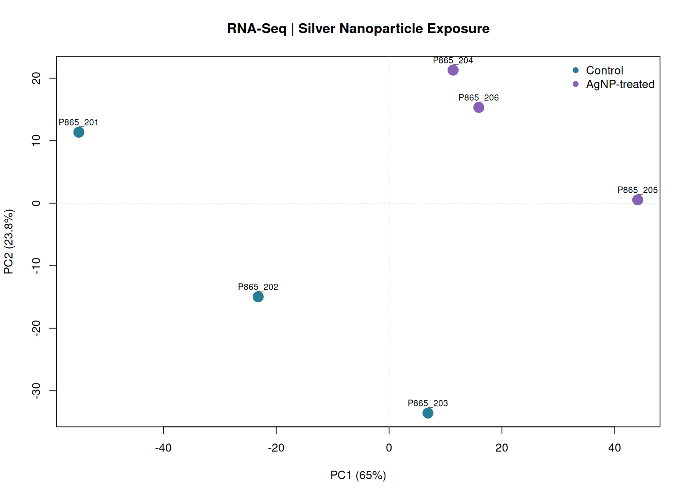
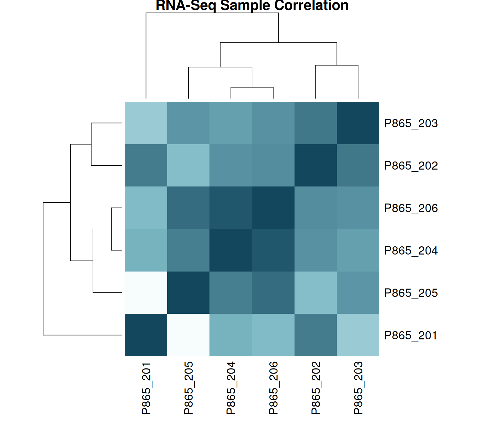
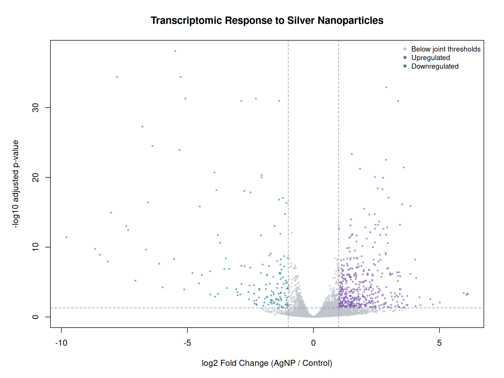
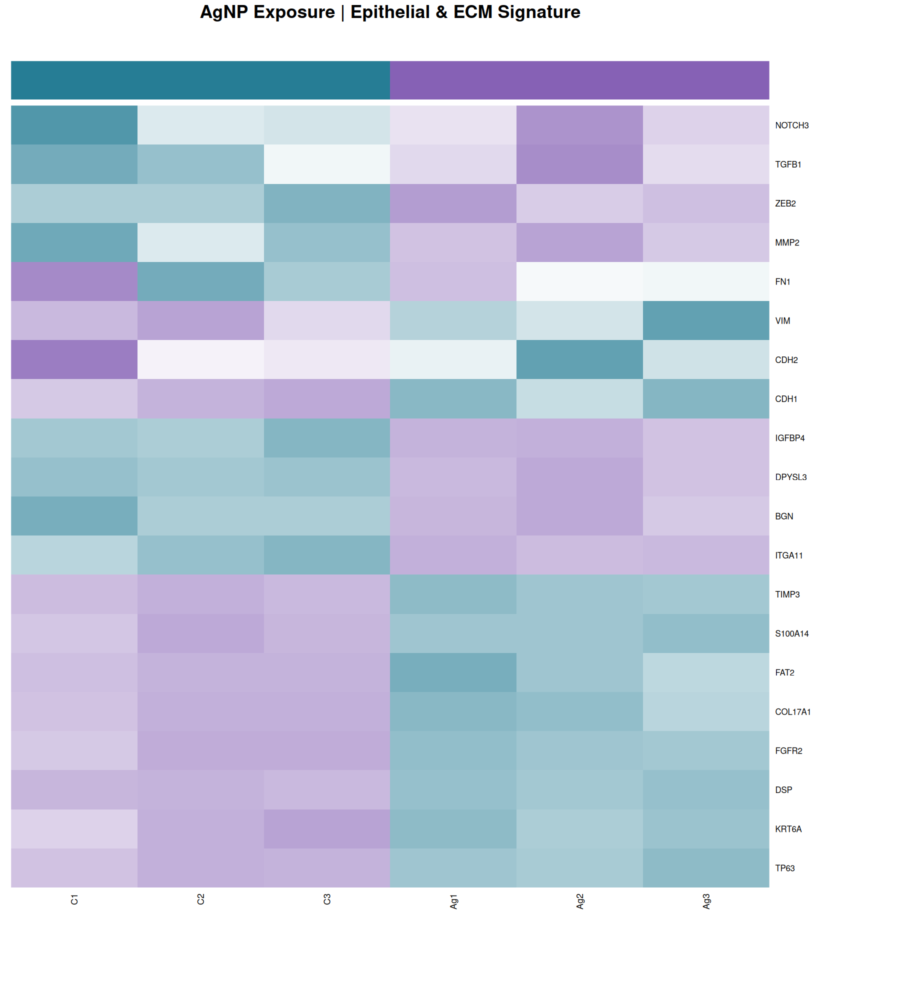

# Transcriptomic Response to Silver Nanoparticle Exposure

### A reproducible RNA-seq reanalysis of human bronchial epithelial cells using R and DESeq2

**Research areas:** Bioinformatics | Nanotechnology | Transcriptomics | Computational Biology

## Overview

How does long-term silver nanoparticle exposure relate to changes in cellular gene expression?

This project presents an independent computational reanalysis of publicly available RNA-seq data from human bronchial epithelial cells (BEAS-2B) exposed to silver nanoparticles (AgNPs).

The objective was to explore differential gene expression and investigate molecular signatures associated with epithelial identity, cell adhesion, and extracellular matrix (ECM) remodeling.

## Dataset

- Accession: E-MTAB-6321
- Source: ArrayExpress / EMBL-EBI BioStudies
- Cell line: BEAS-2B
- Experimental design: 3 control vs 3 AgNP-exposed biological samples
- Exposure: 10 nm citrate-coated silver nanoparticles, 1 ug/mL, six weeks

[Original dataset](https://www.ebi.ac.uk/biostudies/arrayexpress/studies/E-MTAB-6321)

## Computational workflow

1. Import RNA-seq raw count matrix.
2. Inspect sample-level quality metrics.
3. Filter low-count gene features.
4. Perform exploratory PCA on log2(CPM + 1) data.
5. Examine Pearson sample correlations.
6. Perform differential expression analysis with DESeq2.
7. Annotate Ensembl gene IDs using HGNC.
8. Explore selected epithelial and ECM-associated genes.

## Key results

| Metric | Result |
|---|---:|
| Gene features in original matrix | 63,152 |
| Features retained after filtering | 15,344 |
| Features with FDR < 0.05 | 1,215 |
| Features with FDR < 0.05 and abs(log2FC) > 1 | 618 |
| Upregulated | 468 |
| Downregulated | 150 |
| PCA variance explained by PC1 | 65.01% |

## Results and visualizations

### 1. Principal Component Analysis

Exploratory PCA shows separation of control and AgNP-exposed samples along PC1.



### 2. Sample correlation

Pearson correlation analysis reveals high overall sample similarity, with some heterogeneity among controls.



### 3. Differential gene expression

DESeq2 identified 618 gene features meeting the joint FDR and log2 fold-change criteria.



### 4. Biological signature

Exploratory examination of a selected 20-gene panel suggests changes consistent with epithelial and ECM remodeling.



## Biological interpretation

Selected genes involved in epithelial identity and adhesion, including TP63, CDH1, KRT6A, and DSP, displayed reduced expression in the AgNP-exposed group.

Other genes, including ITGA11, BGN, MMP2, and ZEB2, displayed increased expression.

These findings are consistent with aspects of epithelial remodeling and selected EMT-associated features.

However, the transcriptional data alone do not establish a complete epithelial-mesenchymal transition phenotype.

The gene signature panel was selected for exploratory interpretation, not as an independent validation or a pathway enrichment result.

## Reproducibility

Analysis environment:
- R
- DESeq2 1.42.0
- HGNC gene annotation data

The original RNA-seq counts and HGNC annotation dataset are downloaded from their respective public sources and are not redistributed in this repository.

To download the source files from the project root:

```bash
mkdir -p data results figures

curl -fL \
  -o data/count_table_Ag10.txt \
  "https://www.ebi.ac.uk/biostudies/files/E-MTAB-6321/count_table_Ag10.txt"

curl -fL \
  -o data/hgnc_complete_set.txt \
  "https://storage.googleapis.com/public-download-files/hgnc/tsv/tsv/hgnc_complete_set.txt"
```

To reproduce the workflow:

```bash
Rscript scripts/01_quality_control.R
Rscript scripts/02_sample_correlation.R
Rscript scripts/03_deseq2_analysis.R
Rscript scripts/04_volcano_plot.R
Rscript scripts/05_gene_annotation.R
Rscript scripts/06_biological_signature.R
```

DESeq2 must be installed before running scripts 03 and 06.

## Limitations

This is a reanalysis of previously published data, not a new exposure experiment.

The sample size is limited to three biological replicates per group. Differences in sequencing depth and possible technical effects should be considered.

The differential expression results are exploratory and depend on the analysis workflow, gene filtering, and statistical thresholds.

## Data attribution

Gliga AR et al. (2018).

*RNA-sequencing reveals long-term effects of silver nanoparticles on human lung cells.*

Scientific Reports.

https://doi.org/10.1038/s41598-018-25085-5

Dataset: E-MTAB-6321.

## Project scope

An independent educational and research portfolio project exploring how computational transcriptomics can complement the study of nanomaterial-biological system interactions.
